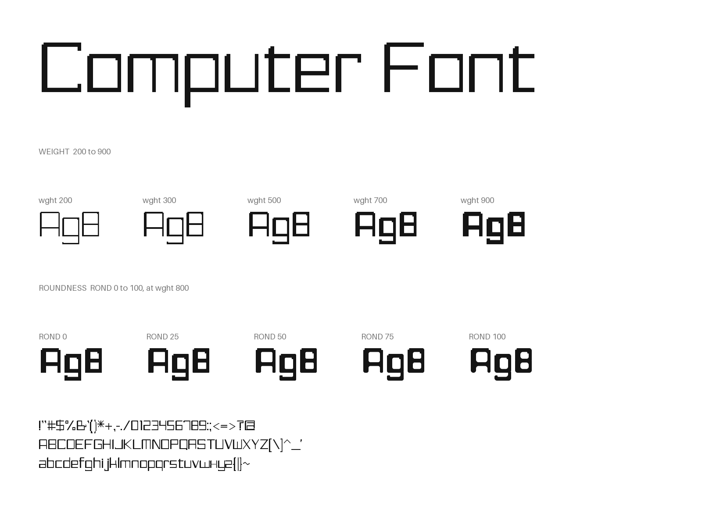

# Computer Font



Computer Font is a parametric, open-source display typeface inspired by blocky 1970s computer lettering. Every glyph is drawn in code as an orthogonal polygon, so the same design can be regenerated at any weight and corner radius. The project builds a single variable OpenType font from Python sources, with no hand-drawn outlines and no copied artwork.

## Features

- **Two variation axes:** `wght` (200 ExtraLight to 900 Black) and `ROND` (0 sharp to 100 fully rounded corners), with named instances from ExtraLight to Black in Sharp and Round styles.
- **ASCII character set:** printable ASCII (U+0020 to U+007E), 95 glyphs plus `.notdef`.
- **Open license:** the font is released under the SIL Open Font License 1.1, and the build code under MIT.
- **Reproducible builds:** Python generates UFO masters, and fontmake compiles a variable TTF and WOFF2.

## Using the font

Download the latest `ComputerFont-<version>.zip` from the [GitHub Releases](https://github.com/areimel/computer-font/releases) page and unzip it. It contains `fonts/variable/` (the variable TTF and WOFF2), `fonts/static/` (one TTF per named instance), and `OFL.txt`.

Load the variable WOFF2 in CSS. The `font-weight` range in `@font-face` lets the browser drive the `wght` axis, and `font-variation-settings` sets `ROND`:

```css
@font-face {
  font-family: "Computer Font";
  src: url("fonts/variable/ComputerFont%5Bwght,ROND%5D.woff2") format("woff2");
  font-weight: 200 900;
  font-style: normal;
}

.display {
  font-family: "Computer Font", monospace;
  font-weight: 700;                    /* wght axis */
  font-variation-settings: "ROND" 50;  /* 0 = sharp, 100 = fully round */
}
```

Avoid setting `"wght"` inside `font-variation-settings`, because it overrides `font-weight`.

The named instances are also available as static files in `fonts/static/`, for tools that do not read variable fonts:

| Weight | Sharp (ROND 0) | Round (ROND 100) |
|---|---|---|
| 200 ExtraLight | Computer Font-ExtraLight.ttf | Computer Font-Round ExtraLight.ttf |
| 300 Light | Computer Font-Light.ttf | Computer Font-Round Light.ttf |
| 400 Regular | Computer Font-Regular.ttf | Computer Font-Round Regular.ttf |
| 500 Medium | Computer Font-Medium.ttf | Computer Font-Round Medium.ttf |
| 700 Bold | Computer Font-Bold.ttf | Computer Font-Round Bold.ttf |
| 900 Black | Computer Font-Black.ttf | Computer Font-Round Black.ttf |

## Building

Requires Python 3.11 or newer.

```sh
make setup    # create .venv and install dependencies (editable install)
make build    # generate UFO masters and compile fonts into fonts/
make test     # run the pytest suite
make proof    # render a weight x radius specimen grid into proofs/
```

Other targets:

- `make reference` downloads the original font for visual comparison (see below).
- `make clean` removes `build/`, `fonts/`, `sources/generated/`, and `proofs/`.

## Previewing

- **Glyph previews:** `scripts/render_glyphs.py` draws glyphs straight from the parametric source, one row per master, without running fontmake. It is the fastest way to check a change:

  ```sh
  PYTHONPATH=src .venv/bin/python scripts/render_glyphs.py "Ag8" out.png
  PYTHONPATH=src .venv/bin/python scripts/render_glyphs.py --all out.png
  ```

- **Specimen sheets:** `make proof` writes `proofs/grid.png` (wght x ROND) and `proofs/waterfall.png` (sizes). `python -m computerfont.proof --readme` regenerates the banner at `docs/images/specimen.png`.
- **Browser specimen:** run `make build`, then open `specimen/index.html` in a browser. It loads the built WOFF2 and has sliders for weight, roundness, and size.

## Project layout

```
computer-font/
  README.md  CLAUDE.md  CHANGELOG.md  CONTRIBUTORS.txt  AUTHORS.txt
  OFL.txt  LICENSE-CODE  .gitignore  requirements.txt  Makefile  pyproject.toml
  .github/workflows/build.yml         # test, build, proof; release on v* tags
  docs/images/specimen.png            # README banner (made by proof --readme)
  docs/superpowers/specs/2026-11-26-computer-font-design.md
  scripts/
    fetch_reference.sh                # downloads original into reference/ (gitignored)
    render_glyphs.py                  # fast per-master glyph preview PNG
  src/computerfont/
    config.py        # family name, UPM, metrics, axis ranges, master parameters
    geometry.py      # points, polygons, orthogonal path builder helpers
    corners.py       # compatible corner rounding (degenerate at radius 0)
    components.py    # reusable parts: stem, bar, bowl, notch, dot, tail, comma
    registry.py      # @glyph decorator and lookup
    glyphs/          # basic.py uppercase.py uppercase_diag.py lowercase.py
                     # digits.py punctuation.py symbols.py (README.md: how to add a glyph)
    ufo.py           # draws the registry into a ufoLib2 font per master
    spacing.py       # per-group sidebearings and space width
    kerning.py       # kerning groups and weight-scaled pairs
    designspace.py   # two axes, six masters, named instances
    build.py         # CLI: UFOs -> variable TTF, WOFF2, static instances
    proof.py         # PNG specimens: wght x ROND grid, waterfall, README banner
  tests/             # conftest, geometry, corners, master compatibility, charset
  specimen/
    index.html       # browser test page with wght and ROND sliders
    specimen.css
  build/ fonts/ sources/generated/ reference/ proofs/   # generated, gitignored
```

## How glyphs are drawn

Each glyph is an **orthogonal polygon**: a list of vertices whose coordinates are expressions of shared metrics such as stem width, notch depth, and cap height. Boolean operations are never used, so the point structure of a glyph does not change between masters.

Every corner is emitted as a cubic curve with two off-curve handles. At radius 0 the handles sit on the corner, so sharp outlines remain structurally compatible with rounded ones. The radius of each corner is clamped so it fits its adjacent edges.

The variable font interpolates between six masters: `wght` at 200, 400 (the default) and 900, crossed with `ROND` at 0 and 100. `ROND` is a percentage of the maximum radius, which is half the local stem.

## Reference

`make reference` runs `scripts/fetch_reference.sh`, which downloads the original 1992 display face into the gitignored `reference/` folder. It is used only for visual comparison while drawing. The original file is never committed or redistributed. Its license is unknown, and the outlines in this project are an independent redraw.

## Roadmap

Version 0.1 covers printable ASCII with two axes. Planned next:

- **Latin-1 accents and symbols:** the accented letters and symbols beyond ASCII.
- **A width axis:** a third axis for condensed and extended forms.
- **Hinting:** instructions for small sizes on screens.

## License

- **Fonts:** SIL Open Font License 1.1. See [OFL.txt](OFL.txt).
- **Build code:** MIT. See [LICENSE-CODE](LICENSE-CODE).

Copyright 2026 The Computer Font Project Authors. Authors are listed in [AUTHORS.txt](AUTHORS.txt).
